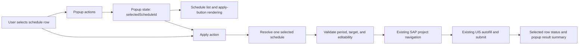

# Implementation plan: Single schedule application

## Feature and spec reference

- **Feature:** Single schedule application
- **Specification:** `.github/specs/021-single-schedule-apply/spec.md`

## Scope and assumptions

### In scope

- Enforce a single selected schedule across project and general-hours schedules.
- Submit only that schedule per apply action, without continuing to another schedule or project.
- Keep the existing selected-schedule result indicator and popup status summary tied to the one schedule.
- Show applied and failed dates as ungrouped lists, and use the singular `Toegepast schema:` heading.
- Preserve the existing target-availability, selected-period, and locked-timesheet checks.
- Add focused model, action, rendering, and integration tests for single-selection behavior.

### Out of scope

- Changes to creating, editing, storing, or expanding schedules.
- Displaying apply results on the SAP timesheet page.
- Changes to SAP navigation, UI5 autofill behavior, or the data submitted for a schedule.
- A broader redesign of the schedule list or apply-result presentation.

### Assumptions

- The selected schedule may be deselected by selecting it again, preserving the current toggle interaction; selecting a different schedule replaces the current selection.
- A scalar `selectedScheduleId: string | null` is the clearest state representation for the single-selection constraint. Existing rendering can continue to identify the selected row and present its existing apply status.
- Any invalid or stale selected schedule must result in no apply rather than falling back to another schedule.

## Architecture overview

The popup remains the entry point and owns selection state. Schedule-row interactions update that state, rendering reflects it across the combined project and general-hours list, and the apply action resolves exactly one saved schedule before calling the existing project navigation and UI5 autofill flow. Existing availability and editability validation remains ahead of the operation; the result for the selected row and the popup summary are updated on completion. The summary identifies the schedule with a singular heading and displays applied and failed dates without project grouping.

## Technical approach

### Design and key decisions

- Replace the `selectedScheduleIds` set in `PopupState` with a nullable selected schedule ID. Initialize it to `null`.
- Update schedule selection handling so selecting a different row replaces the selected ID and re-renders all rows; selecting the currently selected row clears the selection. Use the same list and state for project and general-hours schedules so the limit applies across both types.
- Pass the scalar selection through schedule rendering and derive selected-row styling and accessible checked state from that ID. Keep the apply button disabled when there is no selection, as well as under the existing no-schedule, missing-period, locked, and applying conditions.
- Resolve the selected schedule from the currently rendered schedule collection at apply time. Abort with the existing explicit unavailable-schedule error if that ID no longer resolves; never apply a fallback. Remove multi-schedule loops and aggregate accumulators from the action path, and pass only that schedule's result to the status-message builder.
- Keep schedule target validation, tab validation, navigation, autofill, submission confirmation, error handling, and final button-state restoration in their current order and behavior. Ensure a failure for the selected schedule terminates that one action without retrying another saved schedule or navigating to another target.
- Update the result-message builder to emit the singular `Toegepast schema:` heading and list applied and failed dates directly, without nesting or grouping them by project. Keep persistent popup status output specific to the selected schedule and update only its row status. Avoid unrelated changes to SAP APIs and schedule storage.

### Data and interface contracts

- Change the popup-local state contract from `selectedScheduleIds: Set<string>` to `selectedScheduleId: string | null`; no shared domain type, extension message, storage schema, or persisted schedule format needs to change.
- Update helper and rendering interfaces that currently accept a set of IDs so they accept a nullable ID or otherwise operate on exactly one selected schedule.
- Keep `WeeklySchedule`, `TimesheetSnapshot`, `ScheduleAutofillSummary`, and the UI5 scripting contract unchanged.
- Keep the existing status levels and submission-confirmation details. Change the result contract so it uses the singular `Toegepast schema:` heading and ungrouped applied/failed date lists for the one selected schedule.

### Behavior and error handling

- Selecting an unselected schedule clears any previous selection and enables apply when other existing prerequisites are met. Selecting the active schedule again clears it and disables apply.
- Apply remains unavailable without a selection. If called despite a disabled control, the action returns an explicit warning and makes no SAP calls.
- Before navigation, verify the selected schedule still exists and its target remains present in the current snapshot. Missing selection, missing period, unavailable target, invalid active tab, or locked timesheet must preserve existing status/error behavior and must not result in another schedule being applied.
- During apply, disable the button and display applying status only for the selected row. On success, partial completion, navigation/autofill failure, or SAP non-confirmation, show the existing appropriate result for that schedule, with ungrouped date lists and the singular heading, and restore the button state in `finally`.

## Affected files and responsibilities

| File or area                          | Responsibility and planned changes                                                                                                                                                                                   |
| ------------------------------------- | -------------------------------------------------------------------------------------------------------------------------------------------------------------------------------------------------------------------- |
| `src/popup/popup-model.ts`            | Represent selection as one nullable ID and update the schedule-resolution helper to return at most the selected schedule.                                                                                            |
| `src/popup/popup-actions.ts`          | Replace-or-clear selection in the row callback; update button-state checks; make apply process exactly one resolved schedule and remove multi-schedule aggregation/iteration while preserving validation and errors. |
| `src/popup/popup-render.ts`           | Render selected state using a single ID and retain correct apply-button disabled state and selected-row result display.                                                                                              |
| `src/popup/popup.ts`                  | Update selection access and button-state wiring to use the nullable selected ID.                                                                                                                                     |
| `src/popup/schedule-apply.ts`         | Change the apply-result message builder to use the singular schedule heading and ungrouped applied/failed date lists.                                                                                                |
| `src/popup/popup-model.test.ts`       | Test selected-ID resolution, no selection, stale IDs, and that the helper cannot return multiple schedules.                                                                                                          |
| `src/popup/popup-actions.test.ts`     | Test replacing and clearing selection, one-schedule apply, no unintended calls for unavailable/locked cases, and result association with the selected schedule.                                                      |
| `src/popup/popup-render.test.ts`      | Test selected-row rendering and apply-button availability for selected versus unselected state.                                                                                                                      |
| `src/popup/schedule-apply.test.ts`    | Test singular schedule-heading text and flat applied/failed date lists without project grouping.                                                                                                                     |
| `src/popup/popup.integration.test.ts` | Verify selecting a project schedule and then a general-hours schedule leaves only the latter selected and applies only it.                                                                                           |

## Implementation milestones

### Milestone 1: Enforce one selected schedule in popup state and rendering

**Progress:** Complete.

- Replace the set of selected IDs with the nullable single ID in popup model initialization and relevant popup wiring.
- Update schedule row interaction to replace the previous selection or clear the current selection on repeat activation.
- Update row rendering, selected styling, accessible checked state, and apply-button enablement to reflect the single ID.
- Add focused model and rendering tests, including selection replacement across schedule target types.

#### Completion criteria

At all times the popup state contains no more than one selected schedule. Selecting a second schedule leaves only that row selected, selecting the selected row clears the selection, and apply is disabled without a selection.

### Milestone 2: Apply and report only the selected schedule

**Progress:** Complete.

- Resolve the selected schedule once at apply time and preserve the existing locked, period, tab, and target validations.
- Remove iteration across selected schedules and process only that schedule through existing navigation and autofill.
- Ensure selected-row applying/result state and the popup status summary identify only the submitted schedule; show applied and failed dates without project grouping and use the singular `Toegepast schema:` heading.
- Add action, result-builder, and integration tests covering successful apply, ungrouped date lists, unavailable or locked targets, no selection, and no continuation to another schedule/project.

#### Completion criteria

An apply action can navigate and invoke autofill for at most one schedule, reports only that schedule's outcome under the singular heading with flat applied/failed date lists, makes no fallback attempt when it is invalid, and retains existing target and locked-timesheet behavior.

## Testing and validation

### Unit tests

- Model: initialization has no selection; resolving no selection returns no schedule; resolving a valid ID returns only its schedule; a stale ID does not select a fallback.
- Selection actions: choosing a different ID replaces the prior one across project and general-hours types; choosing the active ID deselects it; button state reflects selection.
- Apply action: no selection, locked timesheet, invalid period, unavailable target, and non-SAP active tab do not navigate or autofill; a valid selection invokes navigation/autofill once for only that schedule; success, partial result, and failure update the correct selected row and status.
- Result builder: the applied-schedule heading is exactly `Toegepast schema:`; applied and failed dates are listed directly and are not grouped under a project name, including partial and full-failure results.
- Rendering: only the selected row receives selected styling and checked state; applying status remains attached to the selected row; apply is disabled when selection is absent.
- Retain existing schedule expansion, navigation, UI5 scripting, and status-format tests as regression coverage.

### Integration or UI tests

- Simulate selecting one project schedule and then a general-hours schedule; assert the first is deselected and only the latter is applied.
- Simulate applying one schedule while other schedules remain saved; assert no second navigation/autofill occurs, the displayed result names only the selected schedule with the singular heading, and its dates are ungrouped.
- Verify existing lock and unavailable-target behavior blocks the action without applying another schedule.

### Other checks

- Run the focused popup unit and integration tests with the repository's Vitest test command.
- Run the project build and formatter check to detect type/build regressions and formatting issues.
- Manually verify popup selection, deselection, and apply-button state for mixed project and general-hours schedule lists if browser-level testing is available.

## Security, privacy, and reliability

### Security and privacy

No material impact: the feature changes popup-local selection and dispatch behavior only. It does not add permissions, external communication, persisted data, or new data exposure. Continue validating that the selected target exists in the current snapshot before invoking SAP navigation or autofill.

### Reliability

Resolve the one selected ID against the current rendered schedule list at the moment of apply to prevent stale IDs from causing fallback behavior. Reuse existing validation and `finally` restoration so errors cannot leave the apply control stuck in an applying state. Keep the SAP call path serial and bounded to one target.

## Risks and mitigations

| Risk                                                                                                                                | Mitigation                                                                                                                                                                                                 |
| ----------------------------------------------------------------------------------------------------------------------------------- | ---------------------------------------------------------------------------------------------------------------------------------------------------------------------------------------------------------- |
| Some UI or tests continue to expect a set of selected IDs after the state contract changes.                                         | Update all state consumers and tests in the same milestone; use TypeScript errors and focused popup tests to locate missed references.                                                                     |
| A stale or deleted selected ID could otherwise cause a different schedule to be applied.                                            | Resolve the exact ID from current schedules and stop with an explicit error when it cannot be found; never choose the first available schedule.                                                            |
| Simplifying result aggregation and removing project grouping could inadvertently remove failure details or submission confirmation. | Keep existing status-level and submission-confirmation logic while changing only the applied-schedule label and date-list structure; add regression cases for partial, failed, and unconfirmed submission. |
| A row can be selected while a schedule form is open or being edited.                                                                | Preserve current editing restrictions and selection clearing for the edited schedule; verify the form lifecycle in popup action and integration tests.                                                     |

## Open questions

- None.
