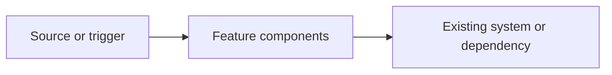

# Implementation plan: [Feature name]

## Feature and spec reference

- **Feature:** [Feature name]
- **Specification:** [Relative path to the feature's `spec.md`]

## Executive summary and desired outcomes

[Summarize the proposed solution, why it is needed, and the user or system outcomes it should achieve.]

- [List a measurable or observable desired outcome.]

## Scope, assumptions, and constraints

### In scope

- [Describe the work required to meet the specification.]

### Out of scope

- [Describe related work intentionally excluded from this plan.]

### Assumptions

- [List assumptions informing the design, or write "None."]

### Constraints

- [List technical, compatibility, policy, or operational constraints, or write "None."]

## Architecture overview

[Explain how the feature fits into the existing system, its boundaries, and the important interactions.]

## Technical approach

### Design and key decisions

- [Describe the proposed design and important decisions, including alternatives considered where they materially affect implementation.]

### Data and interface contracts

- [Describe affected data models, APIs, messages, events, or storage, including compatibility expectations; write "None" if not applicable.]

### Behavior and error handling

- [Describe key flows, validation, failure modes, and recovery behavior.]

## Workstreams and affected files

| Workstream   | File or area | Responsibility and planned changes                          |
| ------------ | ------------ | ----------------------------------------------------------- |
| [Workstream] | `[path]`     | [Describe the changes and ownership or coordination needs.] |

## Dependencies and sequencing

| Dependency or prerequisite                    | Required before           | Notes                                           |
| --------------------------------------------- | ------------------------- | ----------------------------------------------- |
| [Component, decision, or external dependency] | [Workstream or milestone] | [Describe ordering, coordination, or fallback.] |

[Describe any parallel workstreams, critical path, and integration points.]

## Phased implementation milestones

### Phase 1: [Milestone name]

#### Deliverables

- [List the concrete changes produced.]

#### Dependencies

- [List prerequisites, or write "None."]

#### Completion criteria

- [State observable conditions for considering this phase complete.]

### Phase 2: [Milestone name]

#### Deliverables

- [List the concrete changes produced.]

#### Dependencies

- [List prerequisites, or write "None."]

#### Completion criteria

- [State observable conditions for considering this phase complete.]

## Migration, compatibility, and rollout

### Migration

[Describe data, configuration, or user migration steps; write "Not applicable" if none.]

### Compatibility

[Describe supported versions, backward/forward compatibility, and any transition behavior.]

### Rollout and rollback

[Describe release sequencing, feature gating, monitoring, and rollback steps; write "Not applicable" where appropriate.]

## Testing and validation strategy

### Unit tests

[List core logic, boundary conditions, and failure cases to cover.]

### Integration tests

[List component and contract interactions to verify.]

### End-to-end or UI tests

[List user-facing flows to exercise; write "Not applicable" if none.]

### Operational validation

[List relevant build, type-check, lint, performance, monitoring, or manual checks.]

### Acceptance validation

[Map the specification's acceptance criteria to tests or other verification.]

## Security, privacy, and reliability

### Security and privacy

[Describe trust boundaries, sensitive data, permissions, and validation considerations; write "No material impact" with rationale if appropriate.]

### Reliability

[Describe failure containment, recovery, and availability considerations.]

## Risks and mitigations

| Risk                                                                    | Impact                           | Mitigation or detection                           |
| ----------------------------------------------------------------------- | -------------------------------- | ------------------------------------------------- |
| [Describe a likely implementation, compatibility, or operational risk.] | [Describe the potential effect.] | [Describe how to prevent, detect, or address it.] |

## Open questions

- [List unresolved decisions that could affect design, scope, or sequencing, or write "None."]
