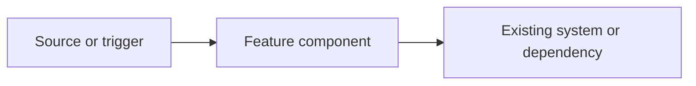

# Implementation plan: [Feature name]

## Feature and spec reference

- **Feature:** [Feature name]
- **Specification:** [Relative path to the feature's `spec.md`]

## Scope and assumptions

### In scope

- [Describe the implementation work required by the specification.]

### Out of scope

- [Describe related work that this plan intentionally excludes.]

### Assumptions

- [List assumptions used to make implementation decisions, or write "None."]

## Architecture overview

[Explain how the feature fits into the existing system and describe the important interactions.]

## Technical approach

### Design and key decisions

- [Describe the proposed design and important implementation decisions.]

### Data and interface contracts

- [Describe affected data models, APIs, messages, or storage; write "None" if not applicable.]

### Behavior and error handling

- [Describe key flows, validation, and failure behavior.]

## Affected files and responsibilities

| File or area | Responsibility and planned changes              |
| ------------ | ----------------------------------------------- |
| `[path]`     | [Describe the changes this file or area needs.] |

## Implementation milestones

### Milestone 1: [Milestone name]

- [Actionable implementation task.]

#### Completion criteria

[Observable result that marks this milestone complete.]

### Milestone 2: [Milestone name]

- [Actionable implementation task.]

#### Completion criteria

[Observable result that marks this milestone complete.]

## Testing and validation

### Unit tests

[List logic and edge cases to cover.]

### Integration or UI tests

[List affected interactions or flows to verify; write "Not applicable" if none.]

### Other checks

[List relevant build, type-check, lint, or manual validation commands.]

## Security, privacy, and reliability

### Security and privacy

[Describe trust boundaries, sensitive data, permissions, and validation considerations; write "No material impact" with rationale if appropriate.]

### Reliability

[Describe failure containment, recovery, and availability considerations.]

## Risks and mitigations

| Risk                                                      | Mitigation                                        |
| --------------------------------------------------------- | ------------------------------------------------- |
| [Describe a likely implementation or compatibility risk.] | [Describe how to prevent, detect, or address it.] |

## Open questions

- [List unresolved implementation decisions, or write "None."]
